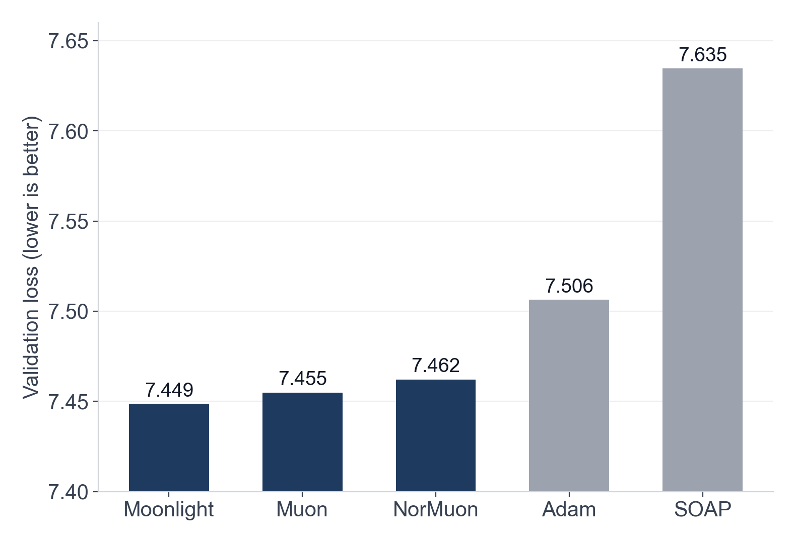

# Muon Optimizer Pretraining Bench

The optimizer decides how the weights change. This repository compares Muon, NorMuon, Moonlight's Muon and SOAP, used unchanged from their official code, against an Adam reference on a small GPT, using the modded-nanogpt optimization track (a fixed GPT and FineWeb data where only the optimizer changes).

## Baseline table

Laptop subset of the track (4 layers x 128, 200 steps x 1,024 tokens). Validation loss on 32,768 FineWeb tokens, lower is better. Every optimizer had its learning rate tuned over 2-3 values.

| Optimizer | Best val loss | Best lr |
|---|---|---|
| Moonlight (Muon) | **7.4487** | 0.002 |
| Muon | 7.4549 | 0.0125 |
| NorMuon | 7.4621 | 0.0175 |
| Adam (reference) | 7.5064 | 0.00075 |
| SOAP | 7.6345 | 0.0015 |

The three Muon-style optimizers reach a lower loss than Adam, which matches the papers; SOAP does not at this size. Each best rate is the lowest rate tried, so lower rates are still to be run. Details and published scores: [BASELINES.md](BASELINES.md).



Print the table from the stored runs:

```bash
python3 benchmark/table.py
```

## Methods and sources

| Optimizer | Official code (pinned, MIT) |
|---|---|
| Muon | KellerJordan/Muon `f98f1ca` |
| NorMuon | zichongli5/NorMuon `c6989a8` |
| Moonlight | MoonshotAI/Moonlight `c2ad5b2` |
| SOAP | nikhilvyas/SOAP `a1e5535` |
| GPT and data | KellerJordan/modded-nanogpt `4ea6b93`, `records/track_3_optimization` |

The vendored files in `baselines/official/` and `env/nanogpt_arch.py` equal upstream, with the same loss and updates (`tests/check_official.py`).

## Quick start

```bash
pip install torch numpy tiktoken
sh data/download.sh                              # 42 MB of FineWeb tokens, checksum-checked
python3 -I env/nanogpt_train.py method=muon      # one laptop run: about 7 min, 1.2 GB
python3 -I env/nanogpt_train.py method=soap lr=0.0015 out=experiments/runs/mine.jsonl
bash reproduce.sh                                # match checks + all baseline runs + manifest (1-1.5 h)
```

`preset=full` runs the official size (12 x 768, 3,250 steps, scored as steps to val loss 3.28); `sh data/download.sh full 20` fetches its data (about 4 GB).

## Files

| Path | What |
|---|---|
| `baselines/official/` | official optimizer code, unchanged, with licenses |
| `baselines/manifest.json` | source, commit, license, changes, match check, our and published score per method |
| `env/nanogpt_arch.py`, `env/nanogpt_train.py` | the track-3 GPT (unchanged) and the trainer |
| `experiments/runs/NANOGPT-OPT.jsonl` | the 14 runs behind the table |
| `experiments/nanogpt_baselines.py`, `make_manifest.py` | run the baselines, write the manifest |
| `third_party/fetch.sh`, `tests/check_official.py` | clone upstream at pinned commits, compare |
| `data/` | download scripts ([DATA.md](DATA.md)) |

Licenses: [LICENSES.md](LICENSES.md).
